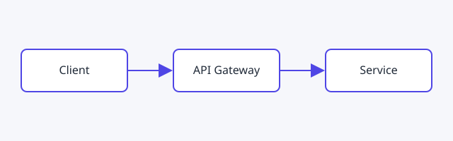

This page lives in the **PortCo 1** repo (`portal-scb`), not in the platform hub.
PortCo 1 edits it, merges to `main`, and PortCo 1's own pipeline publishes it to
its own section of the portal. No other team's section is touched.

## How this section gets published

1. A change is merged to `main` in `portal-scb`.
2. GitHub Actions builds the section with its own base path.
3. The pipeline signs in to Azure as its own deploy identity (OIDC, no secrets).
4. That identity can only write blobs in its own folder of `$web`. An attempt to write
   anywhere else in the storage account is denied.
5. The files are uploaded and the section is live.
