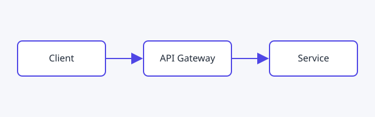

This page lives in the **SCB** repo (`portal-scb`), not in the platform hub.
SCB edits it, merges to `main`, and SCB's own pipeline publishes it to
`/scb/onboarding` on the portal. No other team's section is touched.

## How this section gets published

1. A change is merged to `main` in `portal-scb`.
2. GitHub Actions builds the section with base path `/scb`.
3. The pipeline signs in to Azure as `gh-portal-scb-deploy` (OIDC, no secrets).
4. That identity can only write blobs under `$web/scb/`. An attempt to write
   anywhere else in the storage account is denied.
5. The files are uploaded and the section is live.
